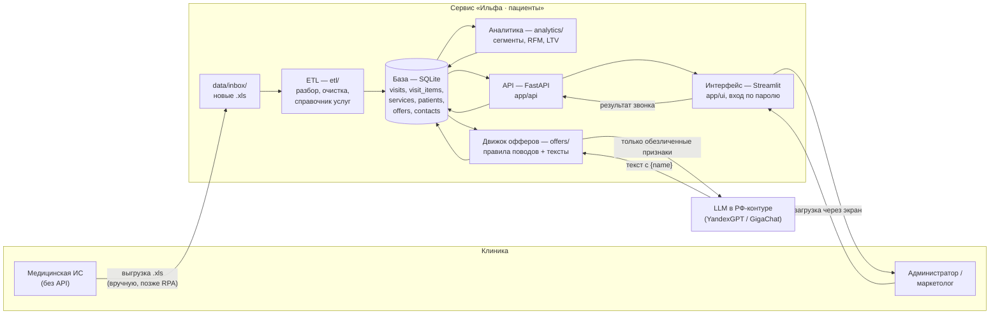

# Архитектура сервиса

## Схема

## Как это работает

1. **Данные.** У медицинской системы нет API, поэтому визиты выгружаются в `.xls`. Файлы загружаются через экран «Загрузка визитов» (или кладутся в папку), ETL добавляет в базу только новые визиты: повторная загрузка не создаёт дублей.
2. **База.** Единая база по контракту `shared/DATA_CONTRACT.md`. Каждая роль пишет только свои таблицы: ETL — визиты, услуги и витрину пациентов, аналитика — сегменты и LTV, движок офферов — поводы и тексты, приложение — результаты контактов.
3. **Аналитика и офферы** пересчитываются по базе (в пилоте — после каждой загрузки или раз в ночь) и записывают результат обратно в базу. Интерфейс ничего не считает, только показывает готовое.
4. **Интерфейс** — рабочее место администратора: «Кому позвонить сегодня» (повод, тон, готовый текст, отметка результата), карточка пациента, сегменты с выгрузкой для рассылки, загрузка данных.

## Персональные данные

- ФИО пациентов хранятся только в базе сервиса, внутри контура клиники.
- **В LLM ФИО не уходят.** Нейросеть получает обезличенные признаки (категории лечения, давность, сегмент, теги) и возвращает текст с плейсхолдером `{name}`. Имя подставляет API при показе администратору.
- Вход в интерфейс — по паролю. API открыт только на самом сервере (`127.0.0.1`), снаружи доступен только интерфейс.
- Ключи (пароль, ключ LLM) — в переменных окружения `.env`, не в коде.

## Стек и масштабирование

| Слой | MVP (сейчас) | При внедрении на всю сеть |
|---|---|---|
| База | SQLite-файл | PostgreSQL |
| Загрузка данных | ручная выгрузка .xls | RPA-выгрузка по расписанию |
| Пересчёт | по команде | ночной планировщик |
| Каналы | звонок, текст для копирования | SMS, мессенджеры, телефония |
| Доступ | общий пароль | учётные записи и роли сотрудников |

Код ETL, аналитики и API работает через SQLAlchemy, поэтому переход на PostgreSQL — это доработка загрузчика и смена строки подключения, а не переписывание сервиса.
