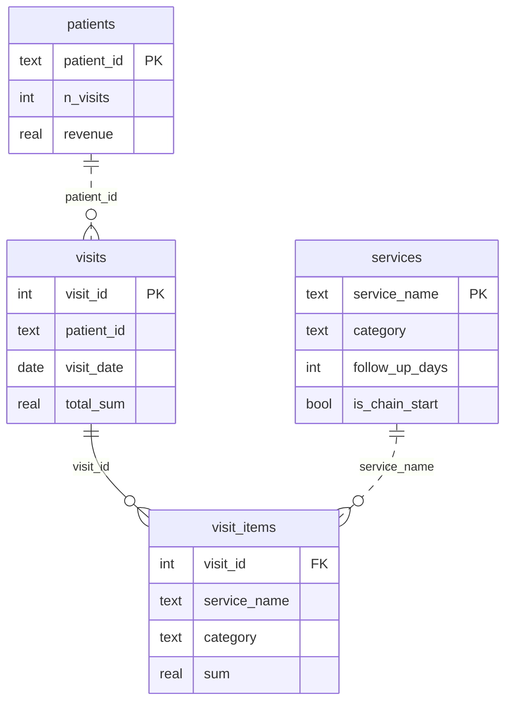

# Локальная загрузка визитов

Для запуска с чистого окружения нужен Python 3.11 или новее.
Из корня репозитория на macOS или Linux выполните:

```sh
python3 -m venv .venv
source .venv/bin/activate
python -m pip install -r etl/requirements.txt
python -m etl.load data/raw/anonymized
```

Перед загрузкой распакуйте исходный архив в `data/raw/anonymized/`.
В Windows для активации окружения используйте `.venv\Scripts\Activate.ps1`
в PowerShell.

По умолчанию загрузчик обновляет локальную SQLite `data/ilfa.db` и сохраняет
рядом `visits.csv` и `visit_items.csv` в UTF-8. Для другой локальной базы
задайте `DATABASE_URL`, например `sqlite:///data/demo.db`.

Для очередной выгрузки передайте папку с новыми файлами или весь архив:

```sh
python -m etl.load data/raw/anonymized --report-date 2026-09-30
```

Загрузчик добавляет новые `visit_id`, обновляет справочник и витрину по всей
накопленной истории и заново формирует оба CSV. Известные `visit_id` пропускаются,
поэтому исправление исходного файла для уже загруженного визита потребует отдельной
процедуры. Ошибка чтения или повторяющийся `visit_id` внутри входной папки отклоняет
всю порцию. В журнал выводятся число файлов, новых визитов, пропусков и ошибок.

Дата отчёта по умолчанию совпадает с максимальной датой визита в базе.
`avg_check` считается как выручка пациента, делённая на число визитов с услугами
и положительной суммой. При отсутствии таких визитов значение равно `NULL`.
Основной врач определяется по числу строк услуг, при равенстве выбирается
первое имя в лексикографическом порядке. Категории пациента уникальны и
отсортированы, имена пациента взяты из последнего визита. Если известные
значения пола расходятся, в витрине используется `unknown`.
Аналитические поля `segment`, `rfm`, `ltv_hist` и `ltv_pred` при добавлении
пациента пустые, при обновлении их значения сохраняются.

Правила из плана применяются по порядку. Дополнительные правила уточняют
только услуги, которые не совпали с исходными правилами. Обе строки с пустым
названием относятся к «Прочее» через одну запись справочника с пустым ключом.



Контрольные итоги полного архива: 8 652 визита, 12 669 строк услуг,
1 918 пациентов и 129 217 716,86 ₽. Сверка и список оставшихся позиций
«Прочее» приведены в [DATA_QUALITY.md](DATA_QUALITY.md).

Для презентации: «8 652 файла визитов собраны в единую SQLite за 3,16 секунды
при контрольном запуске на локальной машине, включая подготовку двух CSV».
